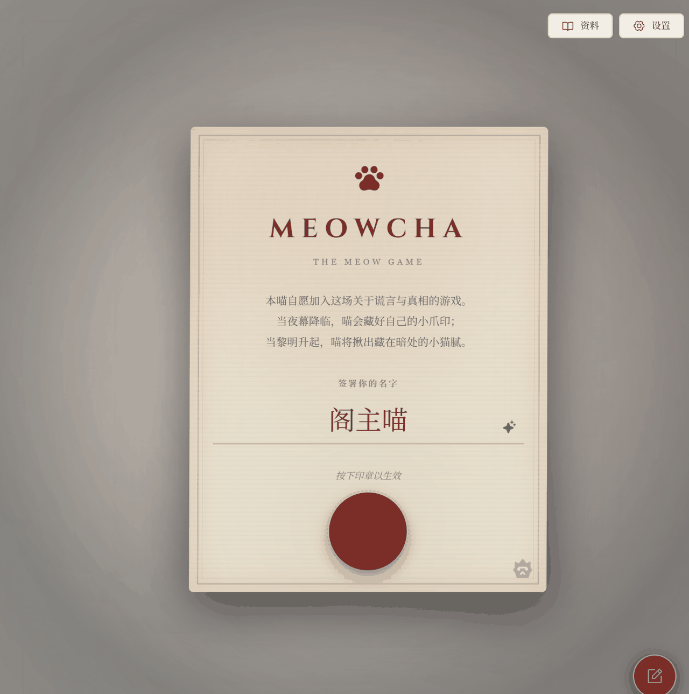
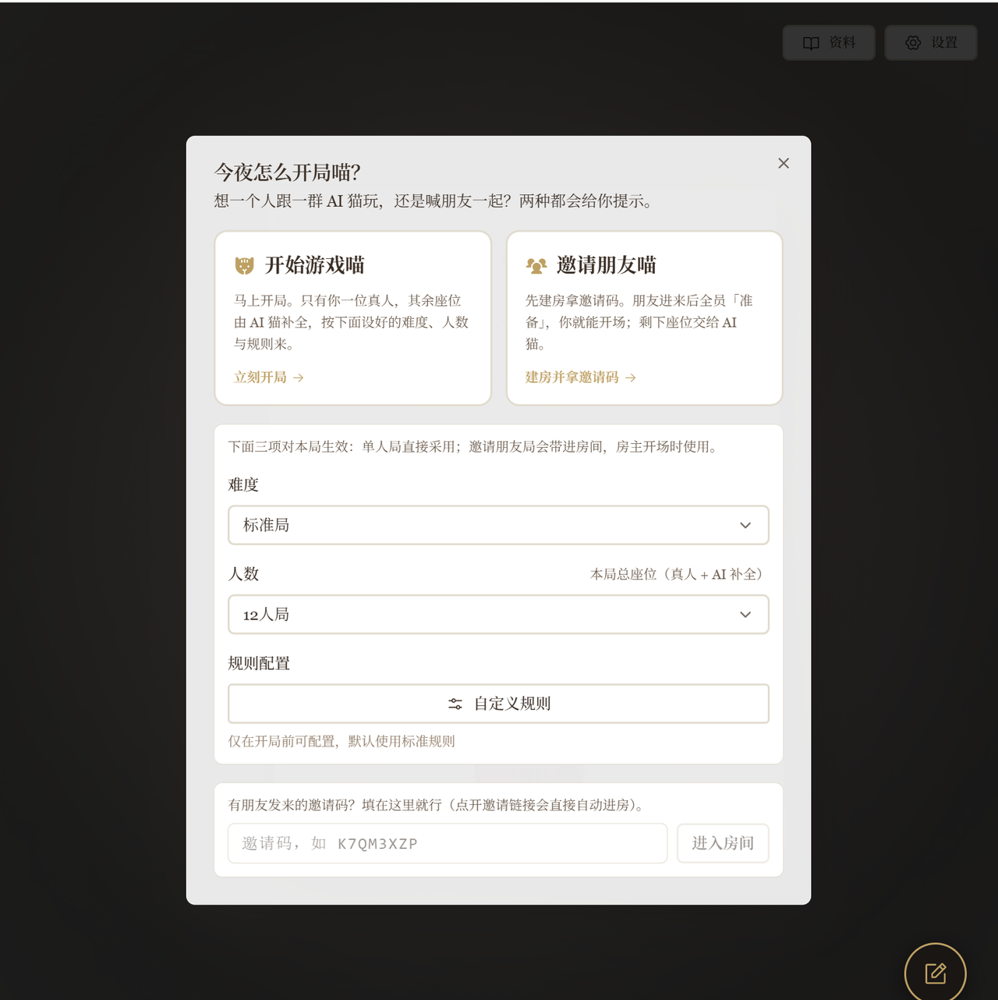
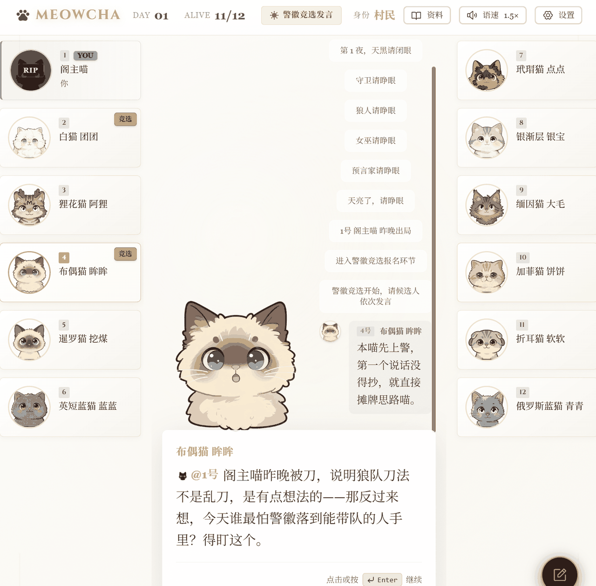
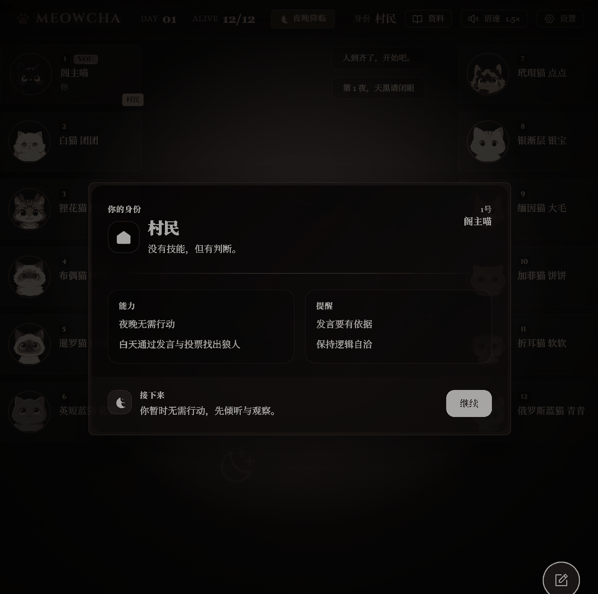
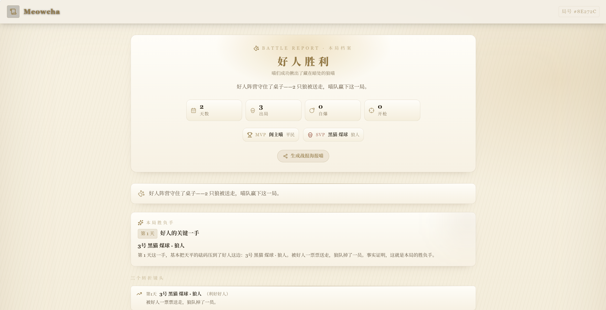
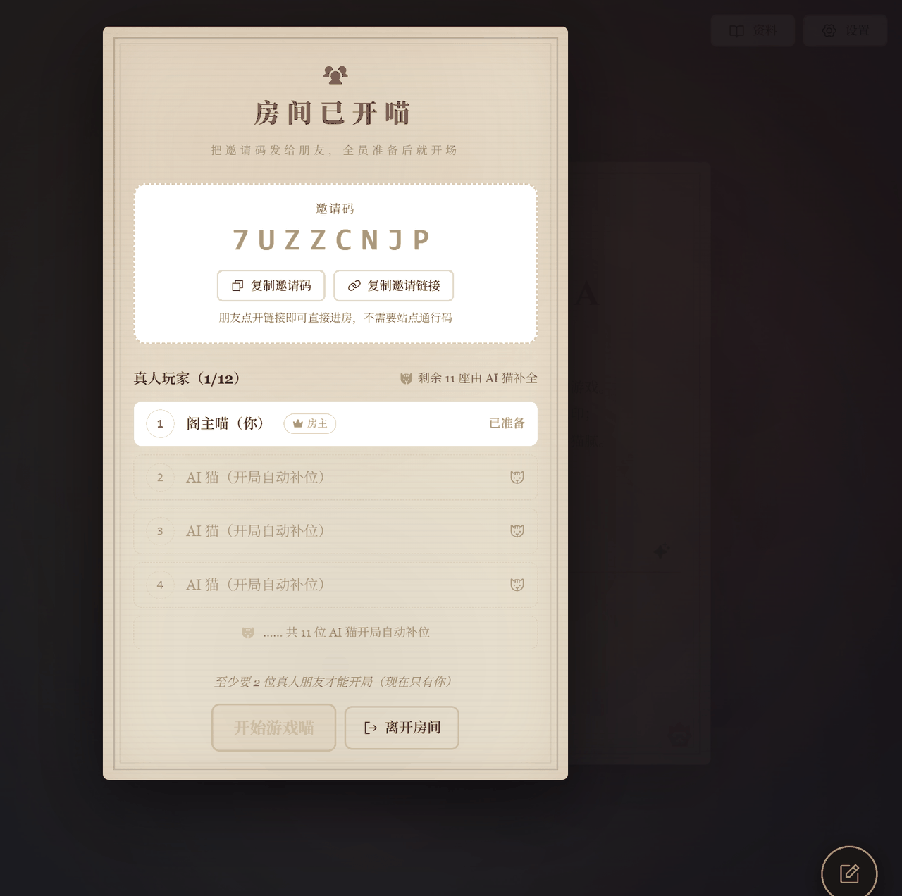
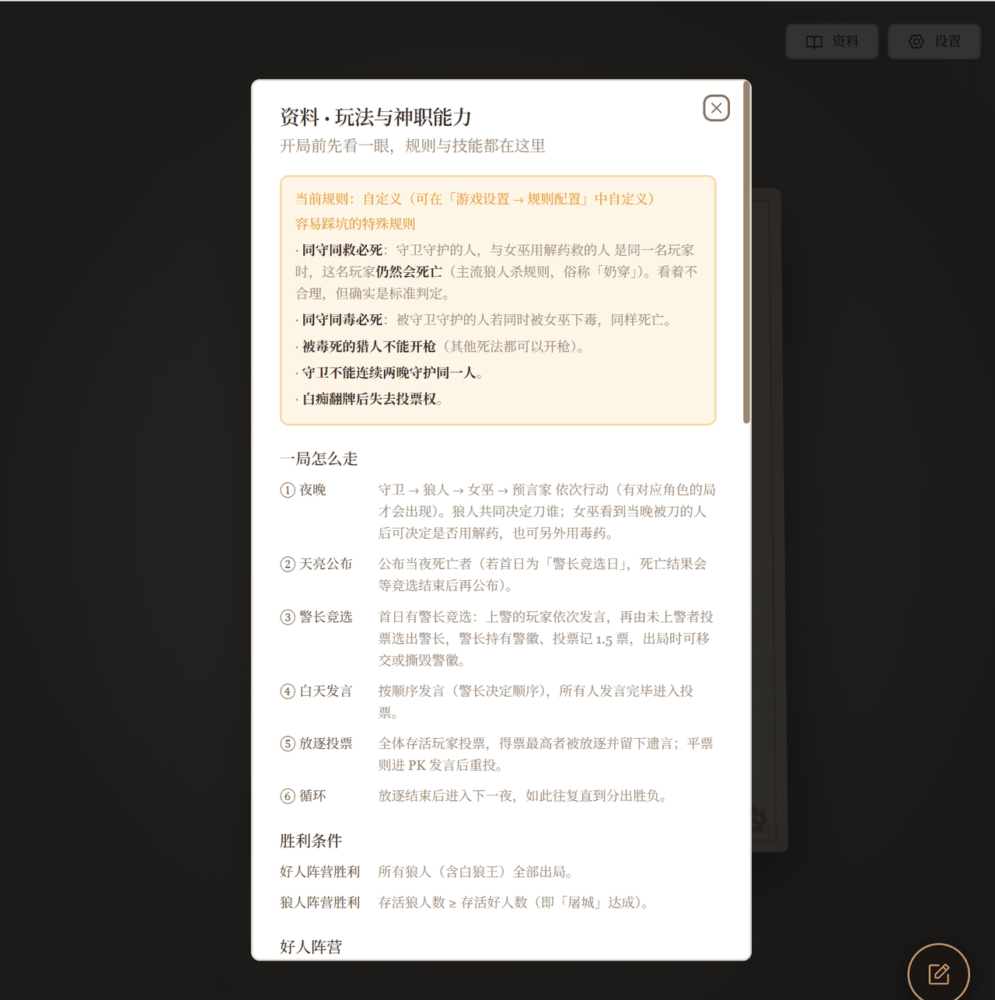

# 喵杀（MEOWCHA）· The Meow Game

> AI 驱动的网页版狼人杀 · 猫猫主题二创。除你之外，桌上所有角色（预言家、女巫、猎人、守卫、狼人……）都由大语言模型实时扮演，你来推理、发言、投票。

**English:** MEOWCHA is an AI-powered web Werewolf/Mafia game with a cat theme, built with Next.js 16. Every non-player character is role-played live by an LLM.

<p>
  <a href="LICENSE"></a>
  
  
  
  
  
  
</p>

> 💡 **完全零基础也能跑起来。** 只要你会复制粘贴命令，就能在本地玩到，也能部署到自己的服务器。全程照着本文和 [`docs/DEPLOY.md`](docs/DEPLOY.md) 走即可。

---

## 📖 目录

- [项目简介](#项目简介)
- [效果预览](#效果预览)
- [功能特性](#功能特性)
- [环境要求](#环境要求)
- [快速开始（本地跑起来）](#快速开始本地跑起来)
- [配置说明](#配置说明)
- [构建与部署](#构建与部署)
- [可选功能（TTS / 联机 / 备案）](#可选功能tts--联机--备案)
- [常见问题](#常见问题)
- [目录结构](#目录结构)
- [致谢与许可](#致谢与许可)
- [免责声明](#免责声明)

---

## 项目简介

**喵杀（MEOWCHA）** 是一款 **AI 驱动的网页版狼人杀**，主题为可爱的猫猫世界。

- **一句话玩法**：你和 5～11 只「AI 猫」同桌，夜里狼人杀猫、神职各显神通，白天大家轮流发言、互相试探，最后投票放逐。你只需要推理、发言、做决定。
- **技术形态**：纯前端 **静态站点**（Next.js 16 静态导出），没有服务端页面；对局完全在你的浏览器里运行。
- **AI 是谁在演**：桌上所有非玩家的角色，都由大语言模型（LLM）实时生成性格、发言与行动。默认接入 **DeepSeek 官方** 的 `deepseek-chat`（可在部署时换成任意兼容 OpenAI Chat Completions 的服务）。
- **主题二创**：本项目的名称、Logo、头像、文案均为重新创作的「猫猫」主题版本，头像使用 16 款**本地内置**的不同品种萌猫插画（完全离线，无任何外部请求）。

> ⚠️ **这是二创项目**。玩法框架来自上游开源项目，本仓库在其基础上做了整体二次创作（更名、换肤、换头像、重写文案与提示词等）。请见文末 [致谢与许可](#致谢与许可)。

---

## 效果预览

> 📸 下列图片放在 [`docs/screenshots/`](docs/screenshots/) 目录；命名约定见 [`docs/screenshots/README.md`](docs/screenshots/README.md)。
> 其中 **01 / 02 / 03 / 05 / 07 / 09** 已随仓库提供；**04 票型 / 06 复盘 / 08 部署** 仍是占位（待补充）。

**欢迎 / 契约页**



**开局设置（人数与房规）**



**对局牌桌（含头像与发言）**



**投票票型卡片**


**夜晚行动**



**复盘 / 洞察页**



**邀请码联机大厅**



**部署示意**


**玩法与神职能力（规则速览）**



---

## 功能特性

| 分类 | 说明 |
| --- | --- |
| 🐱 AI 角色 | 桌上所有非玩家角色由 LLM 实时扮演，各有性格、口吻与逻辑；提示词整体「猫化」，自称「本喵」，自然口语、不油腻 |
| 🎭 多档人数 | **6 / 8 / 10 / 12 人** 四档，默认 **12 人局** |
| 🃏 角色齐全 | 12 人局＝**4 狼（含白狼王）＋ 预言家 / 女巫 / 猎人 / 守卫 ＋ 4 平民**；10 人局含**白痴**（详见下表） |
| ⚙️ 自定义房规 | 开局前可配置：同守同救、女巫自救、被毒死的猎人是否开枪、胜负条件（屠城 / 屠边）、警长票权、白痴翻牌后投票权、白狼王自爆（总开关默认关闭＝标准规则） |
| 🔊 语音朗读 | 可选 TTS：把 AI 台词合成语音播放；不配置也能正常玩 |
| 🎚️ 语速调节 | 游戏内可调节朗读语速 |
| 📊 复盘分析 | 对局结束后提供复盘 / 洞察页，回看角色、票型与关键决策 |
| 👥 邀请码联机 | 可选进阶：2～3 位真人同桌，其余由 AI 补全；房主浏览器跑引擎，客人只渲染自己那份局面 |
| 🎨 视觉 | 复古童话风界面、16 款本地萌猫头像、说话动效、背景音乐与音效 |
| 🌐 中英双语 | 界面与提示词支持简体中文 / English |
| 📖 站内「资料」 | 内置玩法流程、胜负条件、八角色能力说明，以及各人数局的角色构成表 |

**各人数局角色构成：**

| 人数 | 狼 | 神职 | 平民 | 备注 |
| --- | --- | --- | --- | --- |
| 6 人 | 2 | 预言家、女巫 | 2 | — |
| 8 人 | 2 | 预言家、女巫、猎人 | 3 | — |
| 10 人 | 3 | 预言家、女巫、猎人、白痴 | 3 | 含白痴 |
| **12 人（默认）** | 4（含**白狼王**） | 预言家、女巫、猎人、守卫 | 4 | 狼队含白狼王 |

---

## 环境要求

| 项目 | 要求 | 说明 |
| --- | --- | --- |
| **Node.js** | **≥ 20** | ⚠️ **Node 18 太旧，构建会失败**。推荐用 Node 20 的 LTS（或更高）。 |
| **pnpm** | 9.x | 本项目用 **pnpm**（仓库含 `pnpm-lock.yaml`、`pnpm-workspace.yaml`）。用 Node 自带的 `corepack` 即可启用，无需手动下载安装。 |
| 操作系统 | Windows / macOS / Linux | 命令在下方按你熟悉的终端复制即可（Windows 用 PowerShell）。 |
| Git（可选） | 任意版本 | 用「下载 ZIP」方式获取代码时可不装 Git。 |
| 大模型 Key | 一个即可 | 本地开发时建议先配一个 LLM Key（默认 DeepSeek），否则 AI 无法发言。 |
| 内存 | ≥ 4 GB 建议 | 安装依赖与构建时较吃内存。 |

> 💡 **Node 是什么？** Node.js 是运行这套代码的「引擎」。pnpm 是「装零件」的工具。大模型 Key 是让 AI 说话的「钥匙」。下面一步步来。

---

## 快速开始（本地跑起来）

> 目标：在你自己电脑上打开 `http://localhost:3000/meowcha/` 并开始一局。
> 每一步都写了「**应该看到什么**」和「**报错怎么办**」。

### 第 0 步 · 安装 Node.js（≥ 20）

1. 打开官网 <https://nodejs.org/>，下载 **LTS 版本（20 或更高）** 的安装包。
2. 一路「下一步」安装完成。
3. 打开终端（Windows：按 `Win`，输入 `PowerShell`；macOS：打开「终端」），输入：

   ```bash
   node -v
   ```

   **应该看到**：形如 `v20.x.x` 或更高（例如 `v22.11.0`）。
   **报错怎么办**：提示「找不到命令 / command not found」→ Node 没装好或没重启终端，重装后**重开终端**再试。若显示 `v18.*` 或更低 → **必须升级**到 20+，否则后面构建必失败。

### 第 1 步 · 启用 pnpm

Node 自带的 `corepack` 能一键启用 pnpm：

```bash
corepack enable
```

**应该看到**：一般无输出即为成功。
**报错怎么办**：

- Windows 提示权限不足 → 用「以管理员身份运行」的 PowerShell 重开一次。
- 提示 `corepack` 不是命令 → Node 版本太老，先升级 Node。
- 仍不放心可验证：`pnpm -v`，**应该看到** `9.x.x`。

### 第 2 步 · 下载代码

**方式 A（推荐，需要 Git）**：

```bash
git clone <你的仓库地址> meowcha-fork
cd meowcha-fork
```

> 把 `<你的仓库地址>` 换成实际的 GitHub 地址（例如 `https://github.com/<你的用户名>/meowcha.git`）。

**方式 B（不需要 Git）**：在 GitHub 仓库页点绿色 **`Code` → `Download ZIP`**，下载后**解压**，然后在终端 `cd` 进解压出来的目录（例如 `cd meowcha-fork`）。Windows 也可在解压后的文件夹里右键 → 「在终端中打开」。

**应该看到**：`cd` 之后，输入 `ls`（Windows 用 `dir`）能看到 `package.json`、`README.md` 等文件。
**报错怎么办**：`cd` 报「路径不存在」→ 路径拼错，或 ZIP 解压到了别处；重新确认文件夹名。

> 💡 提示：解压/克隆后请**记下这个文件夹的完整路径**，后面 `cd` 都在这里。

### 第 3 步 · 安装依赖

```bash
pnpm install
```

**应该看到**：终端开始下载依赖，最后出现 `Done in xx s`，并生成了 `node_modules/` 文件夹。
**报错怎么办**：

- 网络慢/失败 → 多试一次；国内可先设置镜像：`pnpm config set registry https://registry.npmmirror.com` 后重跑。
- 提示 Node 版本不符 → 回到第 0 步升级 Node。
- 提示 `pnpm-lock.yaml` 不一致 → 确认你**没有**改动 `package.json`，用 `pnpm install --frozen-lockfile` 再试。

### 第 4 步 · 配置大模型（LLM）

AI 角色需要钥匙才能说话。本地开发时，最快的做法是用浏览器手工写入配置（部署时改用自动注入的 `prefill.js`，见 [配置说明](#配置说明)）。

**做法（本地开发）**：

1. 先启动开发服务器（下一步）打开页面，按下 `F12` 打开开发者工具 → `Console`（控制台）。
2. 粘贴下面这段（把 `你的KEY` 换成你的真实 Key）：

   ```js
   localStorage.setItem('meowcha_api_config', JSON.stringify({
     llmProvider: 'deepseek',
     llmBaseUrl: 'https://api.deepseek.com/v1/chat/completions',
     llmApiKey: '你的KEY',
     llmModel: 'deepseek-chat',
     ttsEnabled: false, ttsApiKey: '', ttsGroupId: ''
   }));
   localStorage.setItem('meowcha_custom_key_enabled', 'true');
   localStorage.setItem('meowcha_minimax_api_key', 'self-hosted');
   ```

3. 刷新页面。**应该看到**：进入对局后 AI 能正常发言（不再是空场）。

> 💡 想换服务商？把 `llmProvider` / `llmBaseUrl` / `llmModel` 改成对应值即可（如硅基流动、OpenAI、兼容接口）。不配置 Key 也能进游戏，但 AI 无法发言。

### 第 5 步 · 启动开发服务器

```bash
pnpm dev
```

**应该看到**：终端打印 `Ready`、`Local: http://localhost:3000/meowcha/`。
在浏览器打开 **<http://localhost:3000/meowcha/>**（⚠️ 注意结尾是 `/meowcha/`，因为站点挂在子路径下）。

**报错怎么办**：

- 端口被占用（`Port 3000 is in use`）→ 关掉占用 3000 端口的程序，或临时换端口：`pnpm dev --port 3001`（此时地址变 `http://localhost:3001/meowcha/`）。
- 页面空白 → 先看终端有没有红色报错；再在浏览器 `F12` 看 Console。常见原因是 LLM Key 没配好（第 4 步）。
- 停止服务：在这个终端按 `Ctrl + C`。

> 💡 Windows 用户也可以直接双击仓库根目录的 `start.bat`，它会自动装 pnpm、装依赖并启动（但它提示的地址不含 `/meowcha/`，请以浏览器实际跳转的 `/meowcha/` 为准）。

---

## 配置说明

> 完整清单见 [`docs/CONFIG.md`](docs/CONFIG.md)。下面只列最常用的。

### 一、环境变量（`.env`）

复制模板为 `.env.local`（本地开发）或 `.env`（构建时），按需填写：

```bash
cp deploy/.env.example .env.local     # macOS / Linux
# Windows PowerShell: Copy-Item deploy\.env.example .env.local
```

模板取自仓库内的 [`deploy/.env.example`](deploy/.env.example)。

| 变量 | 必填 | 默认 | 说明 |
| --- | --- | --- | --- |
| `NEXT_PUBLIC_APP_BASEPATH` | 可选 | `/meowcha` | 站点子路径前缀，**必须与 `next.config.ts` 的 `basePath` 一致**。若要部署在根路径 `/`，需同时改这里与 `next.config.ts`。 |
| `NEXT_PUBLIC_SITE_DISPLAY_URL` | 可选 | `lygjk.vip/meowcha` | 分享海报上显示的站点地址（部署到自己的域名时请覆盖为你的地址）。 |
| `NEXT_PUBLIC_SITE_URL` | 可选 | 由上一项拼出 | 分享海报二维码指向的完整地址。 |
| `NEXT_PUBLIC_TTS_ENDPOINT` | 可选 | `/api/tts` | 语音合成端点；默认走同源自建 TTS。 |
| `NEXT_PUBLIC_ICP_NUMBER` | 可选 | 空 | ICP 备案号；不填则不显示备案药丸。 |
| `NEXT_PUBLIC_POLICE_NUMBER` | 可选 | 空 | 公安备案号；同上。 |
| `NEXT_PUBLIC_POLICE_CODE` | 可选 | 空 | 公安备案编号（如 `XXXXXXXXXXXXXXXXXX`）。 |
| `NEXT_PUBLIC_POLICE_BADGE` | 可选 | 空 | 公安备案图标地址（如 `/assets/badge_police.png`）。 |
| `NEXT_PUBLIC_SUPABASE_URL` | 可选 | 空 | 仅「账号 / 额度」相关界面用到；不填不影响单机对局与邀请码联机。 |
| `NEXT_PUBLIC_SUPABASE_ANON_KEY` | 可选 | 空 | 同上。 |
| `NEXT_PUBLIC_APP_VERSION` | 自动 | `package.json` 的 version | 由构建自动注入，无需手填。 |

### 二、大模型（LLM）—— **不走 .env**

> ⚠️ 本项目的 LLM 地址 / 模型 / 密钥**不是**通过环境变量注入的，而是由部署时注入的 **`prefill.js`** 写入玩家浏览器的 **localStorage**（这样玩家无法在界面里改）。

- 模板：[`deploy/prefill.js.example`](deploy/prefill.js.example)。把它复制成 **部署目录下的 `prefill.js`**（与页面同源），把占位符 `__DEEPSEEK_KEY__` 换成你自己的 Key。
- 默认：`llmBaseUrl` = `https://api.deepseek.com/v1/chat/completions`，`llmModel` = `deepseek-chat`。
- **涉及的关键 localStorage 键**（`prefill.js` 会写入并「锁定」它们）：
  `meowcha_api_config`、`meowcha_custom_key_enabled`、`meowcha_zenmux_api_key`、`meowcha_minimax_api_key`、`meowcha_minimax_group_id`。

> ⚠️ **填好 Key 的 `prefill.js` 绝不能提交进仓库**！`.gitignore` 已忽略 `prefill.js`；仓库内只保留脱敏模板。

---

## 构建与部署

### 构建静态产物

```bash
pnpm build
```

**应该看到**：构建成功，终端打印各路由（如 `/` 等）。
产物是纯静态文件，位于 **`out/`**，可以放到任意静态托管或 nginx。

> ⚠️ **构建必须在 Node 20+ 环境进行**。若你本机 Node 太旧，可用官方容器构建（见 [`docs/DEPLOY.md`](docs/DEPLOY.md)）。

### 部署（推荐 nginx）

因为 `basePath = /meowcha`，最简单的方式是**把 `out/` 的内容挂到网站的 `/meowcha/` 路径下**：

1. 把 `out/` 里的内容上传/拷贝到服务器 web 根目录的 `meowcha/` 子目录（让 `index.html`、`_next/`、`brand/`、`bgm/` 等直接位于该目录）。
2. 参照 [`deploy/nginx-meowcha.conf`](deploy/nginx-meowcha.conf) 配置 nginx 的 `location /meowcha/`（含：静态回落、注入 `prefill.js`、修正资源前缀）。
3. 把 [`deploy/prefill.js.example`](deploy/prefill.js.example) 复制为部署目录下的 `prefill.js` 并填入你自己的 Key。
4. `nginx -t && nginx -s reload`。

**想部署在根路径 `/`？** 需要**同时**修改两处：

- `next.config.ts` 里的 `basePath`（改为 `""` 或去掉）；
- `src/lib/site-path.ts` 里的 `BASE_PATH` 默认值（改为 `""`）。

> 📚 **更细的逐步教程（含 nginx 配置、上传步骤、验证命令、TTS 与联机后端）见 [`docs/DEPLOY.md`](docs/DEPLOY.md)。**

---

## 可选功能（TTS / 联机 / 备案）

### 🔊 TTS 语音（可选）

- 前端把 AI 台词 `POST` 到 `process.env.NEXT_PUBLIC_TTS_ENDPOINT ?? "/api/tts"`，请求体 `{ text, voiceId }`，期望返回 **`audio/mpeg`**。
- 可在 nginx 把 `/api/tts` 反代到自建 TTS（如 edge-tts 服务）；[`deploy/nginx-meowcha.conf`](deploy/nginx-meowcha.conf) 里含被注释的 `/api/tts` 示例段。
- **不配置语音也能正常玩。**

### 👥 邀请码联机（可选 / 进阶）

- 玩法：**2～3 位真人**同桌，其余位置由 **AI 补全**；房主浏览器跑游戏引擎，**每 0.8 秒**把「按座位裁剪过的局面」同步到后端房间，客人只渲染自己那份（隐藏信息不会泄露）。
- 需要额外部署一个「**房间存储**」后端（**FastAPI + SQLite**），并在 nginx 上把 `/meowcha/mp/` 反代到该后端。
- **单机游玩完全不需要它。**

### 🧾 备案信息（可选，中国大陆自部署才需要）

- 不填相关环境变量则**不显示**备案药丸。相关变量：`NEXT_PUBLIC_ICP_NUMBER` / `NEXT_PUBLIC_POLICE_NUMBER` / `NEXT_PUBLIC_POLICE_CODE` / `NEXT_PUBLIC_POLICE_BADGE`。

---

## 常见问题

遇到问题先查 [`docs/FAQ.md`](docs/FAQ.md)。高频问题速览：

| 现象 | 可能原因与解决 |
| --- | --- |
| `pnpm install` / 构建失败，Node 版本报错 | Node < 20。升级到 Node 20+（或用 `docs/DEPLOY.md` 里的容器构建）。 |
| 打开的是 404 / 空白页 | 地址必须带子路径：`http://localhost:3000/meowcha/`。 |
| 进游戏后 AI 不说话 | LLM Key 没配好或 Key 无效/欠费。检查 localStorage 里的 `meowcha_api_config`。 |
| 页面能开但图片/音乐 404 | 部署时资源少了 `basePath` 前缀。确认 nginx 的 `sub_filter` 已生效（见 `docs/DEPLOY.md`）。 |
| 语音没声音 | 未部署 TTS 服务或端点未接通。不配语音也能玩。 |
| 联机进不去房间 | 未部署房间后端或 nginx `/meowcha/mp/` 未反代。单机不需要联机后端。 |

---

## 目录结构

```text
meowcha-fork/
├─ src/                      # 应用源码（Next.js App Router）
│  ├─ app/                   # 页面与全局样式入口
│  ├─ components/            # UI 组件（game / analysis / DevTools …）
│  ├─ game/                  # 游戏引擎（阶段、规则、流程）
│  ├─ hooks/                 # React Hooks（含联机 useMeowRoom）
│  ├─ i18n/                  # 中英文案与提示词
│  ├─ lib/                   # 通用逻辑（品牌、站点路径、LLM、房规、TTS …）
│  └─ store/                 # 状态（jotai atoms、状态机）
├─ public/                   # 静态资源（头像、品牌、语音、背景音乐等）
│  ├─ avatars/cats/          # 16 款本地萌猫头像 cat-01 ~ cat-16
│  ├─ brand/                 # 喵杀 Logo / favicon
│  ├─ bgm/ · audio/          # 背景音乐与音效
│  ├─ 模型/ · 职业/          # 角色/模型相关插画
├─ deploy/                   # 部署素材
│  ├─ .env.example           # 环境变量模板
│  ├─ prefill.js.example     # LLM/TTS 配置垫片模板（含占位 Key）
│  ├─ nginx-meowcha.conf     # nginx 站点配置片段
│  └─ README.md              # 部署清单（简版）
├─ docs/                     # 文档
│  ├─ DEPLOY.md              # 详细部署教程
│  ├─ CONFIG.md              # 配置项总表
│  ├─ FAQ.md                 # 常见问题
│  └─ screenshots/           # 截图（占位说明见其 README）
├─ scripts/                  # 构建/生成脚本
├─ next.config.ts            # Next.js 配置（静态导出、basePath…）
├─ package.json              # 依赖与脚本（pnpm）
├─ Dockerfile                # 容器构建（Node 20）
├─ start.bat                 # Windows 一键启动
└─ LICENSE                   # MIT 许可
```

---

## 致谢与许可

- 本项目采用 **MIT License**，详见 [`LICENSE`](LICENSE)。
- 上游原创项目：[**`oil-oil/wolfcha`**](https://github.com/oil-oil/wolfcha)。
- 本版基线：**[`onebai123/wolfcha-web`](https://github.com/onebai123/wolfcha-web)**（纯前端二开版，`output: "export"` 静态导出）。
- 以上上游项目均为 **MIT License**，谨向原作者与所有贡献者致以诚挚敬意。
- ⚠️ **本项目是二创**：名称「喵杀 / MEOWCHA」、Logo、16 款萌猫头像、界面视觉与全部文案均在本版本中**重新创作**，与上游原品牌无关。仓库内保留上游 `LICENSE`（`Copyright (c) 2026 onebai123`）。

---

## 免责声明

- 游戏中所有 AI 角色的发言、行为均由**大语言模型自动生成**，仅供娱乐，**不代表本项目作者的观点或立场**。
- 本项目仅供**休闲娱乐**，请勿用于**赌博**或任何违法违规用途。
- 建议 **18 岁以上** 用户游玩。
- AI 生成内容可能存在不准确、不当或令人不适之处，请理性看待、友好交流。
