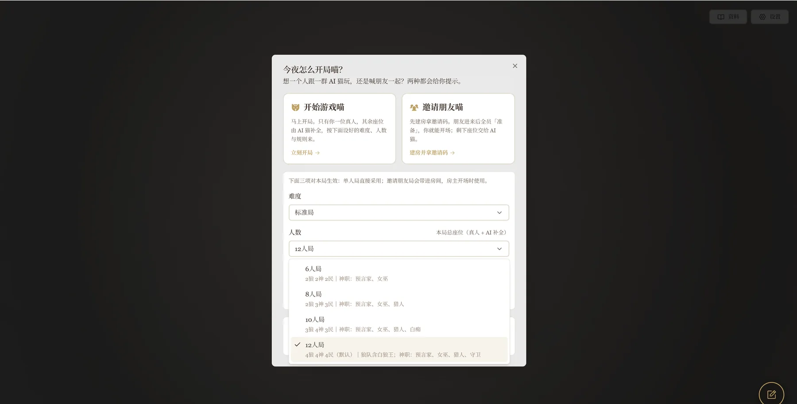
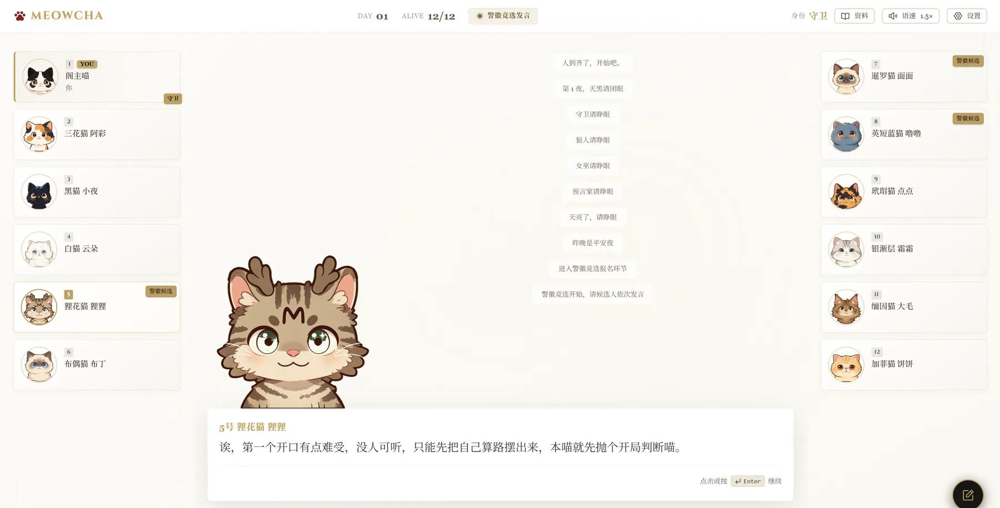
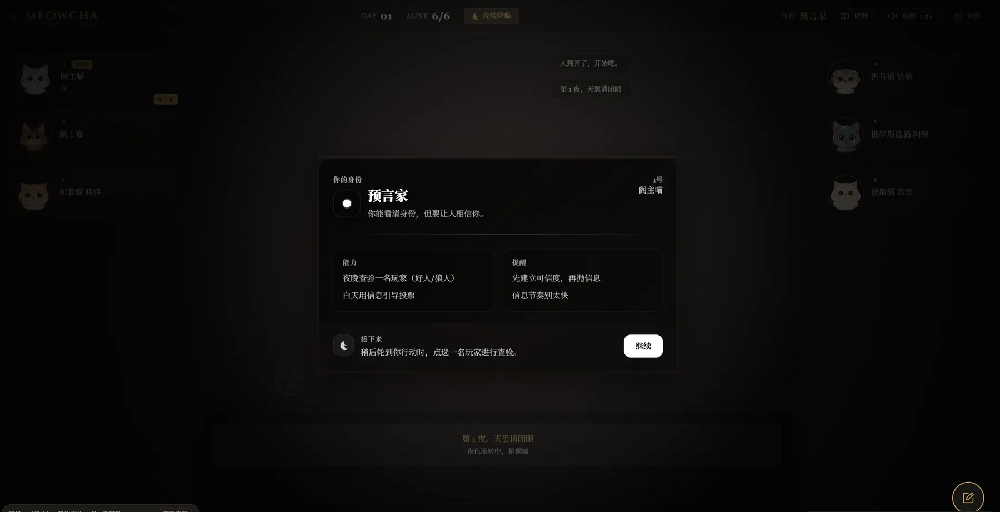
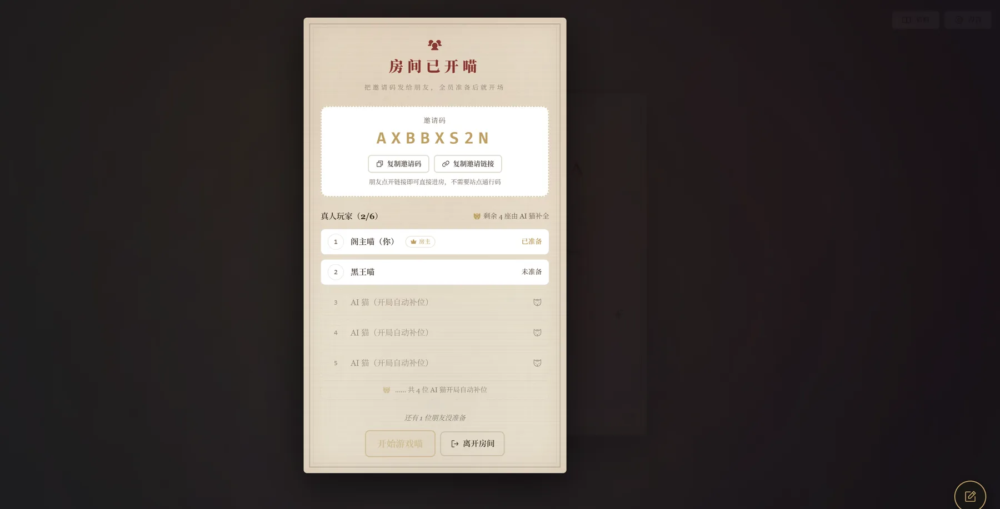
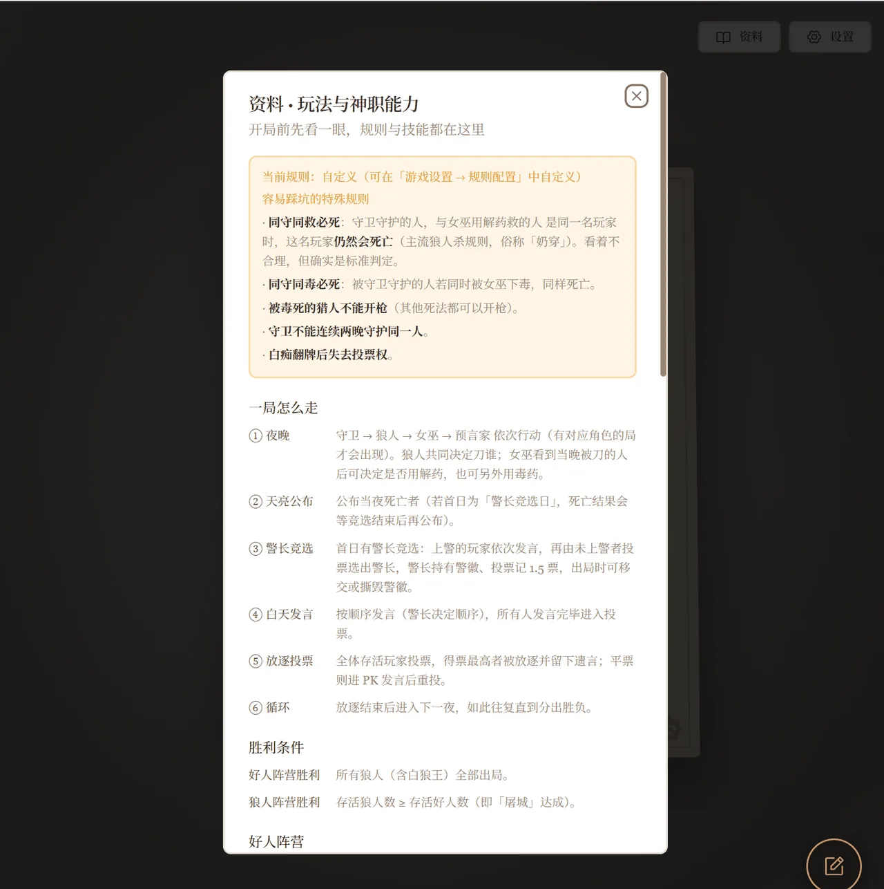
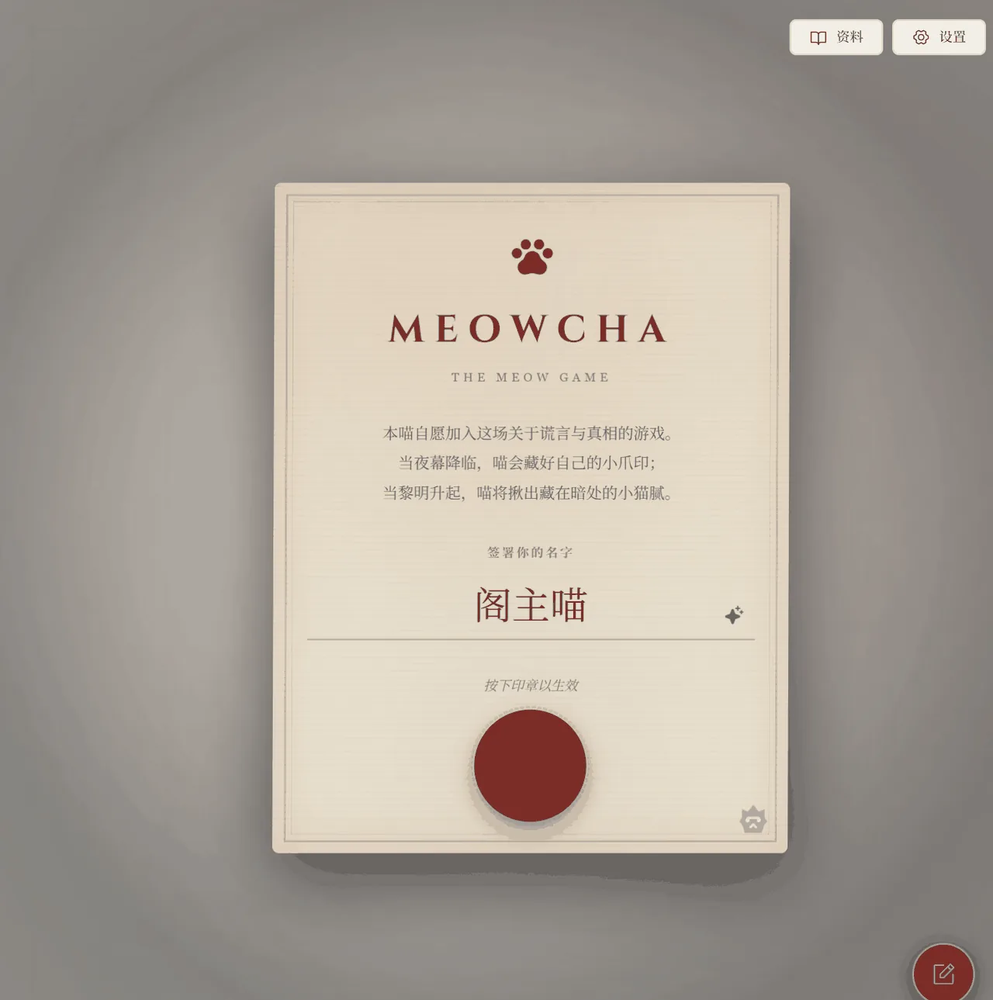

# 🐾 喵杀（MEOWCHA）· The Meow Game

### 可与朋友联机游玩的 AI 网页狼人杀 · 猫猫主题二创

> 桌上除你之外的所有角色——预言家、女巫、猎人、守卫、狼人……**全部由大语言模型实时扮演**。
> 他们自有性格、自有口吻、会撒谎、会带节奏；你只需要做一件事：**推理、发言、投票，然后把谎话藏好喵。**

**English:** MEOWCHA is an AI-powered, cat-themed web Werewolf / Mafia game built with Next.js 16. Every non-player character is role-played live by an LLM — **play solo, or team up with friends via an invite code.**

<p>
  <a href="LICENSE"></a>
  
  
  
  
  
  
  
</p>

> 这份文档写给**想跑起来 / 想部署**的人：每一步都写了「**应该看到什么**」「**报错怎么办**」，带 👤 的段落是**上线到服务器**时的注意事项。

---

## 📖 目录

- [这到底是什么？](#这到底是什么)
- [✨ 亮点速览](#-亮点速览)
- [效果预览](#效果预览)
- [🚀 一键部署（推荐先试这个）](#-一键部署推荐先试这个)
- [手动部署 ①· 环境要求](#手动部署-①-环境要求)
- [手动部署 ②· 在本地跑起来](#手动部署-②-在本地跑起来)
- [手动部署 ③· 构建与上线（nginx）](#手动部署-③-构建与上线nginx)
- [和朋友们联机开一局](#和朋友们联机开一局)
- [配置说明](#配置说明)
- [常见问题](#常见问题)
- [目录结构](#目录结构)
- [致谢与许可](#致谢与许可)
- [免责声明](#免责声明)

---

## 这到底是什么？

**喵杀（MEOWCHA）** 是一款 **AI 驱动的网页版狼人杀**，主题是可爱的猫猫世界。

- 🎮 **一句话玩法**：你和 5～11 只「AI 猫」同桌。夜里狼人杀猫、神职各显神通；白天大家轮流发言、互相试探，最后投票放逐。你只需推理、发言、做决定。
- 🤝 **可联机**：不想一个人玩？用**邀请码联机**——2～3 位真人同桌，剩下的位置由 AI 补全，朋友越多越热闹喵。
- 🧠 **AI 是谁在演**：桌上所有非玩家角色，都由大语言模型实时生成**性格、发言与行动**。默认接入 **DeepSeek** 的 `deepseek-flash`（V4.1 Flash；部署时可换成任意兼容 OpenAI Chat Completions 的服务）。
- 🖥️ **技术形态**：纯前端 **静态站点**（Next.js 16 静态导出），没有服务端页面；对局完全在你的浏览器里运行。
- 🐱 **主题二创**：名称、Logo、头像、文案均为重新创作的「猫猫」主题版本；头像使用 16 款**本地内置**的不同品种萌猫插画（完全离线，无任何外部请求）。

> ⚠️ **这是二创项目**：**喵杀（MEOWCHA）是由 [见星阁主](https://github.com/qq255204159) 开发的狼人杀玩法深度二创版本。** 玩法框架来自上游开源项目，本仓库在其基础上做了整体二次创作（更名、换肤、换头像、重写文案与提示词等）。请见文末 [致谢与许可](#致谢与许可)。

---

## ✨ 亮点速览

| 分类 | 说明 |
| --- | --- |
| 🐱 AI 角色 | 桌上所有非玩家角色由 LLM 实时扮演，各有性格、口吻与逻辑；提示词整体「猫化」，自称「本喵」，自然口语、不油腻 |
| 🤝 邀请码联机 | **2～3 位真人同桌**，其余由 AI 补全；房主浏览器跑引擎，客人只渲染自己那份局面（隐藏信息不泄露） |
| 🎭 多档人数 | **6 / 8 / 10 / 12 人** 四档，默认 **12 人局** |
| 🃏 角色齐全 | 12 人局＝**4 狼（含白狼王）＋ 预言家 / 女巫 / 猎人 / 守卫 ＋ 4 平民**；10 人局含**白痴**（详见下表） |
| ⚙️ 自定义房规 | 开局前可配置：同守同救、女巫自救、被毒死的猎人是否开枪、胜负条件（屠城 / 屠边）、警长票权、白痴翻牌后投票权、白狼王自爆（总开关默认关闭＝标准规则） |
| 🔧 模型可自选 | 游戏首页「**设置 → AI 模型**」里可切换服务商、填 API Key 与模型名，带**测试连通性**按钮；**留空则用服务器默认配置**（详见 [配置说明](#配置说明)） |
| 🔊 语音朗读 | 可选 TTS：把 AI 台词合成语音播放；不配置也能正常玩 |
| 📊 复盘分析 | 对局结束后提供**复盘 / 洞察页**，回看角色、票型、关键决策，还有「幕后狼队夜聊」小剧场 |
| 🎚️ 语速调节 | 游戏内可调节朗读语速 |
| 🎨 视觉 | 复古童话风界面、16 款本地萌猫头像、说话口型动效、背景音乐与音效 |
| 🌐 中英双语 | 界面与提示词支持简体中文 / English |
| 📖 站内「资料」 | 内置玩法流程、胜负条件、八角色能力说明，以及各人数局的角色构成表 |

**各人数局角色构成：**

| 人数 | 狼 | 神职 | 平民 | 备注 |
| --- | --- | --- | --- | --- |
| 6 人 | 2 | 预言家、女巫 | 2 | — |
| 8 人 | 2 | 预言家、女巫、猎人 | 3 | — |
| 10 人 | 3 | 预言家、女巫、猎人、白痴 | 3 | 含白痴 |
| **12 人（默认）** | 4（含**白狼王**） | 预言家、女巫、猎人、守卫 | 4 | 狼队含白狼王 |

---

## 效果预览

**开局设置弹窗（人数与房规）**



**对局牌桌（含头像与发言）**



**夜晚 · 身份牌**



**复盘 / 洞察页**


**邀请码联机大厅**



**玩法与神职能力（规则速览）**



**欢迎 / 契约页**



---


## 🚀 一键部署（推荐先试这个）

仓库里附了 `deploy/docker-compose.yml`：**站点 + 联机房间 + 语音合成**三个服务一起起好，`/meowcha/`、`/meowcha/mp/`、`/api/tts` 三处路由也配好了 —— 你只要：

```bash
cd deploy
cp prefill.js.example prefill.js     # 填上你自己的 LLM Key
docker compose up -d --build         # → 打开 http://localhost:8080/meowcha/
```

**不用写任何代码**，也不用自己实现联机后端或语音服务 —— 两者的实现都在 `deploy/` 里，且已在真实服务器上逐条冒烟验证过。细节见 [`docs/DEPLOY.md`](docs/DEPLOY.md) 第 0 节。

> 🐳 **不想用 Docker？** 下面从「环境要求」开始的整条流程就是**手动部署**：装环境 → 本地跑通 → 构建静态产物 → 自己挂 nginx（联机与语音按需手接）。

---

## 手动部署 ①· 环境要求

> 🐳 走上面的**一键部署**时，这一节可以**整节跳过**：Node / pnpm 都由容器内置好了。

| 项目 | 要求 | 说明 |
| --- | --- | --- |
| **Node.js** | **≥ 20** | ⚠️ **Node 18 太旧，构建会失败**。推荐用 Node 20 的 LTS（或更高）。 |
| **pnpm** | 9.x | 本项目用 **pnpm**（仓库含 `pnpm-lock.yaml`、`pnpm-workspace.yaml`）。用 Node 自带的 `corepack` 即可启用，无需手动下载安装。 |
| 操作系统 | Windows / macOS / Linux | 命令按你熟悉的终端复制即可（Windows 用 PowerShell）。 |
| Git（可选） | 任意版本 | 用「下载 ZIP」方式获取代码时可不装 Git。 |
| 大模型 Key | 视情况 | 部署方已提供默认配置时可跳过；否则需在游戏首页「**设置 → AI 模型**」里填一个，否则 AI 猫不会说话。 |
| 内存 | ≥ 4 GB 建议 | 安装依赖与构建时较吃内存。 |

---

## 手动部署 ②· 在本地跑起来

### 🚀 最快路线：让 AI 帮你部署（强烈推荐给新人）

> **一行命令都不想敲？没关系喵。**
>
> 把**这个仓库页面**丢给你常用的 AI 助手（Trae / Claude / ChatGPT / 豆包 / DeepSeek / 通义 都行），再补一句话就够了：
>
> ```text
> 帮我按这个 README 把项目跑起来。我只有 Windows，看不懂命令行，请一步步带我操作、把命令写全。
> ```
>
> 它会替你读文档、判断环境、给出**你直接复制就能用**的命令，报错了还会帮你排查。
> 本地跑还是部署上线，都能用它带你走完。

> ℹ️ 以下都是**手动**路线。只想最快跑起来的话，先看上面的「[一键部署](#-一键部署推荐先试这个)」。

### 🧭 先想清楚：你要走哪条路

| 你的目标 | 走到哪 | 大概要做什么 |
| --- | --- | --- |
| 🧪 **先在自己电脑上跑起来试试** | **A. 本地跑起来**（下面第 0～5 步） | 装 Node/pnpm → `pnpm dev` → 打开 `localhost` 就能玩 |
| 🌐 **部署上线、把链接发给朋友玩** | **B. 部署上线**（第 3 步 + [构建与上线](#手动部署-③-构建与上线nginx)） | 同一套代码 → `pnpm build` 出静态产物 → 挂到 nginx / 静态托管 → 配一把 Key |

> 👤 **本教程按「部署者」视角写**：每一步除了「怎么做」，都会用 `👤 部署者注意` 额外说明**上线时要注意什么**。
> A 和 B 用的是**同一份代码**，所以本地先跑通、再部署上线，是最稳的顺序。

> 🎯 **A. 本地跑起来**的目标：在你自己电脑上打开 `http://localhost:3000/meowcha/` 并开始一局。
> 每一步都写了「**应该看到什么**」和「**报错怎么办**」。

### 第 0 步 · 安装 Node.js（≥ 20）

1. 打开官网 <https://nodejs.org/>，下载 **LTS 版本（20 或更高）** 的安装包。
2. 一路「下一步」安装完成。
3. 打开终端（Windows：按 `Win`，输入 `PowerShell`；macOS：打开「终端」），输入：

   ```bash
   node -v
   ```

   **应该看到**：形如 `v20.x.x` 或更高（例如 `v22.11.0`）。
   **报错怎么办**：提示「找不到命令 / command not found」→ Node 没装好或没重启终端，重装后**重开终端**再试。若显示 `v18.*` 或更低 → **必须升级**到 20+，否则后面构建必失败。

> 👤 **部署者注意**：**服务器上也要 Node ≥ 20**。如果服务器不方便装 Node，也可以完全跳过本地 Node，直接用官方容器构建（见 [`docs/DEPLOY.md`](docs/DEPLOY.md)）。

### 第 1 步 · 启用 pnpm

Node 自带的 `corepack` 能一键启用 pnpm：

```bash
corepack enable
```

**应该看到**：一般无输出即为成功。
**报错怎么办**：

- Windows 提示权限不足 → 用「以管理员身份运行」的 PowerShell 重开一次。
- 提示 `corepack` 不是命令 → Node 版本太老，先升级 Node。
- 仍不放心可验证：`pnpm -v`，**应该看到** `9.x.x`。

> 👤 **部署者注意**：服务器上**构建时同样需要 pnpm**；用 `corepack enable` 最省事，不用全局安装。

### 第 2 步 · 下载代码

**方式 A（推荐，需要 Git）**：

```bash
git clone <你的仓库地址> meowcha
cd meowcha
```

> 把 `<你的仓库地址>` 换成实际的 GitHub 地址（例如 `https://github.com/<你的用户名>/meowcha.git`）。

**方式 B（不需要 Git）**：在 GitHub 仓库页点绿色 **`Code` → `Download ZIP`**，下载后**解压**，然后在终端 `cd` 进解压出来的目录（例如 `cd meowcha`）。Windows 也可在解压后的文件夹里右键 → 「在终端中打开」。

**应该看到**：`cd` 之后，输入 `ls`（Windows 用 `dir`）能看到 `package.json`、`README.md` 等文件。
**报错怎么办**：`cd` 报「路径不存在」→ 路径拼错，或 ZIP 解压到了别处；重新确认文件夹名。

>  **部署者注意**：**千万不要把"填了 Key 的文件"提交回你自己的仓库**。仓库里只放模板：`.gitignore` 已忽略 `.env*` 与 `prefill.js`，你部署时在服务器上现填即可。

### 第 3 步 · 安装依赖

```bash
pnpm install
```

**应该看到**：终端开始下载依赖，最后出现 `Done in xx s`，并生成了 `node_modules/` 文件夹。
**报错怎么办**：

- 网络慢/失败 → 多试一次；国内可先设置镜像：`pnpm config set registry https://registry.npmmirror.com` 后重跑。
- 提示 Node 版本不符 → 回到第 0 步升级 Node。
- 提示 `pnpm-lock.yaml` 不一致 → 确认你**没有**改动 `package.json`，用 `pnpm install --frozen-lockfile` 再试。

> 👤 **部署者注意**：**服务器上构建前也要先跑一次 `pnpm install`**。国内服务器建议先设好镜像（见上面第一条），否则可能卡在下载上。

### 第 4 步 · 启动开发服务器

```bash
pnpm dev
```

**应该看到**：终端打印 `Ready`、`Local: http://localhost:3000/meowcha/`。
在浏览器打开 **<http://localhost:3000/meowcha/>**（⚠️ 注意结尾是 `/meowcha/`，因为站点挂在子路径下）。

**报错怎么办**：

- 端口被占用（`Port 3000 is in use`）→ 关掉占用 3000 端口的程序，或临时换端口：`pnpm dev --port 3001`（此时地址变 `http://localhost:3001/meowcha/`）。
- 页面空白 → 先看终端有没有红色报错；再在浏览器 `F12` 看 Console。常见原因是 LLM Key 没配好（下一步）。
- 停止服务：在这个终端按 `Ctrl + C`。

>  **部署者注意**：`pnpm dev` 只是**本地预览**用的，**正式上线不要用它**。上线请改用 `pnpm build` 生成 `out/` 静态产物，再按 [构建与上线](#手动部署-③-构建与上线nginx) 挂到服务器。

### 第 5 步 · 让猫猫开口（配 AI 模型 Key）

AI 角色要靠大语言模型说话，所以**必须有一把可用的 Key**。这里有两种做法，按你的目标选：

**做法 ② · 只是自己先玩 → 在网页里填**

打开页面 → 首页右上角 **【设置】** → **「AI 模型（LLM）」**，填好三项 → 点 **【测试连通性】** 验证 → 点 **【保存】**：

| 填什么 | 例子 |
| --- | --- |
| API 地址 | `https://api.deepseek.com/v1/chat/completions` |
| API Key | 你在模型平台申请的 Key |
| 模型名称 | `deepseek-flash` |

> 🔒 这份配置只写进**你自己浏览器的 localStorage**，请求由浏览器**直连**你所填的模型服务，不经过本站服务器，也不会进 Git 仓库。

**做法 ① · 想部署给朋友「打开就能玩」→ 把 Key 写进服务器端配置文件** 👤

> 💡 编号说明：**① = 服务器默认配置（`prefill.js`）**、**② = 玩家自定义配置（网页「设置」里填的）** —— 与下面「[配置说明](#配置说明)」一节的编号、优先级表完全一致，别记反了喵。

**这正是部署者最该做的**：把 Key 写进**部署目录下的 `prefill.js`**（不是 `.env`，更不是提交进仓库）。

1. 复制模板：[`deploy/prefill.js.example`](deploy/prefill.js.example) → **部署目录下的 `prefill.js`**（与页面同源）。页面自带 `<script src="/meowcha/prefill.js">`，把文件放好即生效。
2. 把里面的占位符 `__DEEPSEEK_KEY__` 换成你自己的真实 Key。
3. 刷新页面即可 —— **朋友打开就直接能玩，零配置**。

**为什么推荐这么做** 👤：

- ✅ **朋友零配置**：一进游戏就有可用 Key，不用挨个教他们怎么填。
- ✅ **公开的代码里看不到 Key**：Key 只存在**服务器的部署目录**里，**不进 Git 仓库**（`.gitignore` 已忽略 `prefill.js`），仓库里只留脱敏模板。
- ✅ **界面里不显示、也不会被误改**：`prefill.js` 把配置写进 localStorage 并「**锁定**」，玩家在设置面板里看不到服务器那把 Key，也不会手滑改坏它（想只改自己那份？见下面的优先级表）。
- ⚠️ **前提：站点不要完全公开**。纯前端站点的 Key 终究会下发到访客浏览器里，所以**只要你的站点有访问限制**（登录闸门 / 只把链接发给朋友 / 内网），这样做就是安全的。
- ⚠️ **如果站点完全公开**：任何访客都能用浏览器开发者工具读到这把 Key（等于把额度借给全网）。这种情况请改用**做法 A**（让玩家填自己的 Key），或者给站点加访问限制。

**两种做法可以叠加**，优先级如下：

| 优先级 | 来源 | 谁在用 |
| --- | --- | --- |
| 最高 | 玩家在【设置 → AI 模型】里填的 | 玩家想换模型 / 想用自己的 Key 时 |
| 次之 | 服务器 `prefill.js` 注入的默认配置 | 玩家没填时自动用它，**朋友开箱即用** |
| 兜底 | 两边都没有 → AI 猫不会说话 | 页面会弹提示，并引导玩家去设置 |

> 💡 **兼容 OpenAI 接口的服务都能用**（DeepSeek / 硅基流动 / OpenAI / 通义 / 自建网关 …）。切换「服务商」下拉，地址与模型会自动带出来。
> 🗣️ **语音朗读**：**端点不需要 Key、也不需要额外配置** —— 只要站点的 `/api/tts` 能返回 mp3，且玩家没关掉「音效 / AI 语音」开关，AI 台词就会朗读。不部署 TTS 服务也能正常玩。

---

## 手动部署 ③· 构建与上线（nginx）

### 构建静态产物

```bash
pnpm build
```

**应该看到**：构建成功，终端打印各路由（如 `/` 等）。
产物是纯静态文件，位于 **`out/`**，可以放到任意静态托管或 nginx。

> ⚠️ **构建必须在 Node 20+ 环境进行**。若你本机 Node 太旧，可用官方容器构建（见 [`docs/DEPLOY.md`](docs/DEPLOY.md)）。

### 部署（推荐 nginx）

因为 `basePath = /meowcha`，最简单的方式是**把 `out/` 的内容挂到网站的 `/meowcha/` 路径下**：

1. 把 `out/` 里的内容上传/拷贝到服务器 web 根目录的 `meowcha/` 子目录（让 `index.html`、`_next/`、`brand/`、`bgm/` 等直接位于该目录）。
2. 参照 [`deploy/nginx-meowcha.conf`](deploy/nginx-meowcha.conf) 配置 nginx 的 `location /meowcha/`（`try_files` 静态回落是**必需**的）。
3. 把 [`deploy/prefill.js.example`](deploy/prefill.js.example) 复制为部署目录下的 `prefill.js` 并填入你自己的 Key。
4. `nginx -t && nginx -s reload`。

**想部署在根路径 `/`？** 需要**同时**修改两处：

- `next.config.ts` 里的 `basePath`（改为 `""` 或去掉）；
- `src/lib/site-path.ts` 里的 `BASE_PATH` 默认值（改为 `""`）。

> 📚 **更细的逐步教程（含 nginx 配置、上传步骤、验证命令、TTS 与联机后端）见 [`docs/DEPLOY.md`](docs/DEPLOY.md)。**

### 可选 · 让 AI 开口说话（语音朗读）

**不配也能玩**（AI 说的话会以文字气泡显示，只是没有声音）。想让它**读出来**，一共三步：

1. **准备一个「语音服务」**：它接收 `{"text":"要读的台词","voiceId":"音色名"}`，返回一段 **mp3** 就行。最省事的做法是自建 **edge-tts**（用微软 Edge 的在线朗读，**免费、不需要任何 Key**）。
2. **把站点接到它**：前端固定请求同源的 `/api/tts`，所以只要在 nginx 加一段反代：

   ```nginx
   location = /api/tts {
       proxy_pass         http://你的语音服务地址:8000;   # ← 改成你的
       proxy_http_version 1.1;
       proxy_set_header   Connection "";
       proxy_read_timeout 120s;
       proxy_buffering    off;
   }
   ```

   （[`deploy/nginx-meowcha.conf`](deploy/nginx-meowcha.conf) 末尾就有这段的现成模板，取消注释改地址即可。语音服务不在同一台机器时，也可以构建前设 `NEXT_PUBLIC_TTS_ENDPOINT` 指过去。）

3. **验证**：

   ```bash
   curl -s -X POST "https://你的站点/api/tts" \
     -H 'Content-Type: application/json' \
     -d '{"text":"测试","voiceId":"zh-CN-XiaoxiaoNeural"}' -o t.mp3 && ls -l t.mp3   # 期望：拿到一个非空的 mp3
   ```

> 🔊 **玩家端也有开关**：首页右上角【设置】与对局内【设置】里都能调 —— 「音效总开关 / 角色配音」两个开关，外加**背景音乐音量**与**语音音量**两个独立滑杆（2026-10-20 起两者已解耦：把背景音乐拉到 0 不会连语音一起静音）。
> 排查（返回 JSON 而不是音频、没声音等）见 [`docs/DEPLOY.md`](docs/DEPLOY.md) 第 10 节与 [`docs/FAQ.md`](docs/FAQ.md) 的 E 节。

---

## 和朋友们联机开一局

一个人玩久了，也想拉朋友一起喵？**邀请码联机**就是为这个准备的：**你和 1～2 位朋友真人同桌，空出来的位置由 AI 猫补上**。

### 这事儿要不要折腾？

| 你的情况 | 要做什么 |
| --- | --- |
| 🐱 **只想自己玩** | **什么都不用做。** 单人局不需要房间服务，AI 会把所有位置填满。 |
| 👥 **想和朋友一起玩** | 需要额外跑一个很小的「房间服务」—— 下面两条路都不用写代码。 |

### 部署它：两条路

- **A · 一键起全套（最省事）**：`deploy/docker-compose.yml` 会把「站点 + 房间服务 + 语音服务」一起起好 —— 见 [`docs/DEPLOY.md`](docs/DEPLOY.md) 第 0 节。
- **B · 已经有一台服务器**：起 `deploy/meowroom/` 里那个现成的房间服务（`docker build` + `docker run` 两条命令），再在 nginx 把 `/meowcha/mp/` 反代过去 —— 配置照 [`deploy/nginx-meowcha.conf`](deploy/nginx-meowcha.conf) 复制、改地址，然后 `nginx -t && nginx -s reload`。

> ⚠️ **唯一容易踩的坑**：反代里 **`proxy_buffering off;` 不能省**。联机靠「服务器主动推消息」（SSE）工作，不关缓冲会表现成「**连上了，却一直收不到朋友的动静**」。完整可用配置见 [`docs/DEPLOY.md`](docs/DEPLOY.md) 第 11 节。

> 🐱 **没配好也不影响单机**：联机只是「朋友要一起玩」时才需要的东西。

---

## 配置说明

> 完整清单见 [`docs/CONFIG.md`](docs/CONFIG.md)。下面只列最常用的。

### 一、环境变量（`.env`）

复制模板为 `.env.local`（本地开发）或 `.env`（构建时），按需填写：

```bash
cp deploy/.env.example .env.local     # macOS / Linux
# Windows PowerShell: Copy-Item deploy\.env.example .env.local
```

模板取自仓库内的 [`deploy/.env.example`](deploy/.env.example)。

| 变量 | 必填 | 默认 | 说明 |
| --- | --- | --- | --- |
| `NEXT_PUBLIC_APP_BASEPATH` | 可选 | `/meowcha` | 站点子路径前缀，**必须与 `next.config.ts` 的 `basePath` 一致**。若要部署在根路径 `/`，需同时改这里与 `next.config.ts`。 |
| `NEXT_PUBLIC_SITE_DISPLAY_URL` | 可选 | `your-domain.example/meowcha` | 分享海报上显示的站点地址（**部署到自己的域名时请覆盖为你的地址**）。 |
| `NEXT_PUBLIC_SITE_URL` | 可选 | 由上一项拼出 | 分享海报二维码指向的完整地址。 |
| `NEXT_PUBLIC_TTS_ENDPOINT` | 可选 | `/api/tts` | 语音合成端点；默认走同源自建 TTS。 |
| `NEXT_PUBLIC_ICP_NUMBER` | 可选 | 空 | ICP 备案号；不填则不显示备案药丸。 |
| `NEXT_PUBLIC_POLICE_NUMBER` | 可选 | 空 | 公安备案号；同上。 |
| `NEXT_PUBLIC_POLICE_CODE` | 可选 | 空 | 公安备案编号（如 `XXXXXXXXXXXXXXXXXX`）。 |
| `NEXT_PUBLIC_POLICE_BADGE` | 可选 | 空 | 公安备案图标地址（如 `/assets/badge_police.png`）。 |
| `NEXT_PUBLIC_SUPABASE_URL` | 可选 | 空 | 仅「账号 / 额度」相关界面用到；不填不影响单机对局与邀请码联机。 |
| `NEXT_PUBLIC_SUPABASE_ANON_KEY` | 可选 | 空 | 同上。 |
| `NEXT_PUBLIC_APP_VERSION` | 自动 | `package.json` 的 version | 由构建自动注入，无需手填。 |

### 二、大模型（LLM）—— **不走 `.env`**，分成两层

> ⚠️ 本项目的 LLM 地址 / 模型 / 密钥**不是**通过环境变量注入的，而是存放在**玩家浏览器的 localStorage** 里，共两层：

| 层级 | 存在哪 | 作用 |
| --- | --- | --- |
| ① 服务器默认配置 | 部署时由 **`prefill.js`** 写入 `meowcha_api_config` 并锁定 | 玩家一进来就有默认 Key，**开箱即用**；适合自用 / 小范围分享 |
| ② 玩家自定义配置 | 玩家在游戏首页「**设置 → AI 模型**」填写，写入 `meowcha_user_api_config` | **填写后优先于 ①**；不填则自动回落到 ① |

**优先级：② > ① > 未配置**（两层都没有 → AI 猫不会说话，页面会提示并引导玩家去设置）。

> 👤 **部署者一句话结论**：**想让朋友「打开就能玩」，就用做法 ①** —— 把 Key 写进部署目录的 `prefill.js`：朋友零配置，Key 也不会带进公开仓库。
> 但**站点完全公开时**，Key 终究会下发到访客浏览器、能被读出来；这种情况请改用做法 ②（让玩家填自己的 Key），或给站点加访问限制。细节见上面的「手动部署 ②· 在本地跑起来 · 第 5 步」。

**做法 ①（推荐部署者）：统一提供 Key，让朋友开箱即用**

- 模板：[`deploy/prefill.js.example`](deploy/prefill.js.example)。把它复制成 **部署目录下的 `prefill.js`**（与页面同源），把占位符 `__DEEPSEEK_KEY__` 换成你自己的 Key。
- 默认：`llmBaseUrl` = `https://api.deepseek.com/v1/chat/completions`，`llmModel` = `deepseek-flash`。
- `prefill.js` 会写入并「锁定」这些键：
  `meowcha_api_config`、`meowcha_custom_key_enabled`、`meowcha_zenmux_api_key`、`meowcha_minimax_api_key`、`meowcha_minimax_group_id`。
  > 注意：② 用的是**另一个**键（`meowcha_user_api_config`），**不在锁定名单里** —— 所以玩家始终能在设置里覆盖 ①。

> ⚠️ **填好 Key 的 `prefill.js` 绝不能提交进仓库**！`.gitignore` 已忽略 `prefill.js`；仓库内只保留脱敏模板。

---

## 常见问题

遇到问题先查 [`docs/FAQ.md`](docs/FAQ.md)。高频问题速览：

| 现象 | 可能原因与解决 |
| --- | --- |
| `pnpm install` / 构建失败，Node 版本报错 | Node < 20。升级到 Node 20+（或用 `docs/DEPLOY.md` 里的容器构建）。 |
| 打开的是 404 / 空白页 | 地址必须带子路径：`http://localhost:3000/meowcha/`。 |
| 进游戏后 AI 不说话 | 两层 LLM 配置都没有，或 Key 无效/欠费。先在首页【设置 → AI 模型】看状态提示；服务器默认配置看 `prefill.js`，玩家自己填的看 localStorage 的 `meowcha_user_api_config`。 |
| 页面能开但图片/音乐 404 | `out/` 没**平铺**到 `/meowcha/` 目录下（或漏传了 `_next/`、`brand/`、`bgm/`、`音频/` 等子目录）。 |
| 语音没声音 | 未部署 TTS 服务或端点未接通。不配语音也能玩。 |
| 联机进不去房间 | 未部署房间后端或 nginx `/meowcha/mp/` 未反代。单机不需要联机后端。 |

---

## 目录结构

```text
meowcha/
├─ src/                      # 应用源码（Next.js App Router）
│  ├─ app/                   # 页面与全局样式入口
│  ├─ components/            # UI 组件（game / analysis / DevTools …）
│  ├─ game/                  # 游戏引擎（阶段、规则、流程）
│  ├─ hooks/                 # React Hooks（含联机 useMeowRoom）
│  ├─ i18n/                  # 中英文案与提示词
│  ├─ lib/                   # 通用逻辑（品牌、站点路径、LLM、房规、TTS …）
│  └─ store/                 # 状态（jotai atoms、状态机）
├─ public/                   # 静态资源（头像、品牌、语音、背景音乐等）
│  ├─ avatars/cats/          # 16 款本地萌猫头像 cat-01 ~ cat-16
│  ├─ brand/                 # 喵杀 Logo / favicon
│  ├─ bgm/ · audio/          # 背景音乐与音效
│  ├─ 模型/                  # 各模型提供商的品牌插画（.svg）
├─ deploy/                   # 部署素材
│  ├─ .env.example           # 环境变量模板
│  ├─ prefill.js.example     # LLM/TTS 配置垫片模板（含占位 Key）
│  ├─ nginx-meowcha.conf     # nginx 站点配置片段
│  └─ README.md              # 部署清单（简版）
├─ docs/                     # 文档
│  ├─ DEPLOY.md              # 详细部署教程
│  ├─ CONFIG.md              # 配置项总表
│  ├─ FAQ.md                 # 常见问题
│  └─ screenshots/           # 截图（说明见其 README）
├─ scripts/                  # 构建/生成脚本
├─ next.config.ts            # Next.js 配置（静态导出、basePath…）
├─ package.json              # 依赖与脚本（pnpm）
├─ Dockerfile                # 静态导出镜像：构建 out/ 后用 nginx 托管
├─ .dockerignore             # 镜像构建忽略项（node_modules / out / prefill.js …）
├─ start.bat                 # Windows 一键启动
└─ LICENSE                   # MIT 许可
```

---

## 致谢与许可

- 本项目采用 **MIT License**，详见 [`LICENSE`](LICENSE)。
- 本版二创作者 / 维护者：**[见星阁主](https://github.com/qq255204159)**（GitHub `qq255204159`）—— 「喵杀（MEOWCHA）」正是在其主导下完成的**狼人杀玩法深度二创版本**。
- 上游原创项目：[**`oil-oil/wolfcha`**](https://github.com/oil-oil/wolfcha)。
- 本版基线：**[`onebai123/wolfcha-web`](https://github.com/onebai123/wolfcha-web)**（纯前端二开版，`output: "export"` 静态导出）。
- 以上上游项目均为 **MIT License**，谨向原作者与所有贡献者致以诚挚敬意。
- ⚠️ **本项目是二创**：名称「喵杀 / MEOWCHA」、Logo、16 款萌猫头像、界面视觉与全部文案均在本版本中**重新创作**，与上游原品牌无关。仓库内保留上游 `LICENSE`（`Copyright (c) 2026 onebai123`）。

---

## 免责声明

- 游戏中所有 AI 角色的发言、行为均由**大语言模型自动生成**，仅供娱乐，**不代表本项目作者的观点或立场**。
- 本项目仅供**休闲娱乐**，请勿用于**赌博**或任何违法违规用途。
- 建议 **18 岁以上** 用户游玩。
- AI 生成内容可能存在不准确、不当或令人不适之处，请理性看待、友好交流。

---

<div align="center">

## ⭐ 求个 Star 喵！

如果这只猫猫陪你度过了一局又一局夜晚，
**点一下右上角的 ⭐ Star** 就是最好的投喂——
它会让我更有动力继续把「猫猫狼人杀」做得更好玩喵～

</div>
